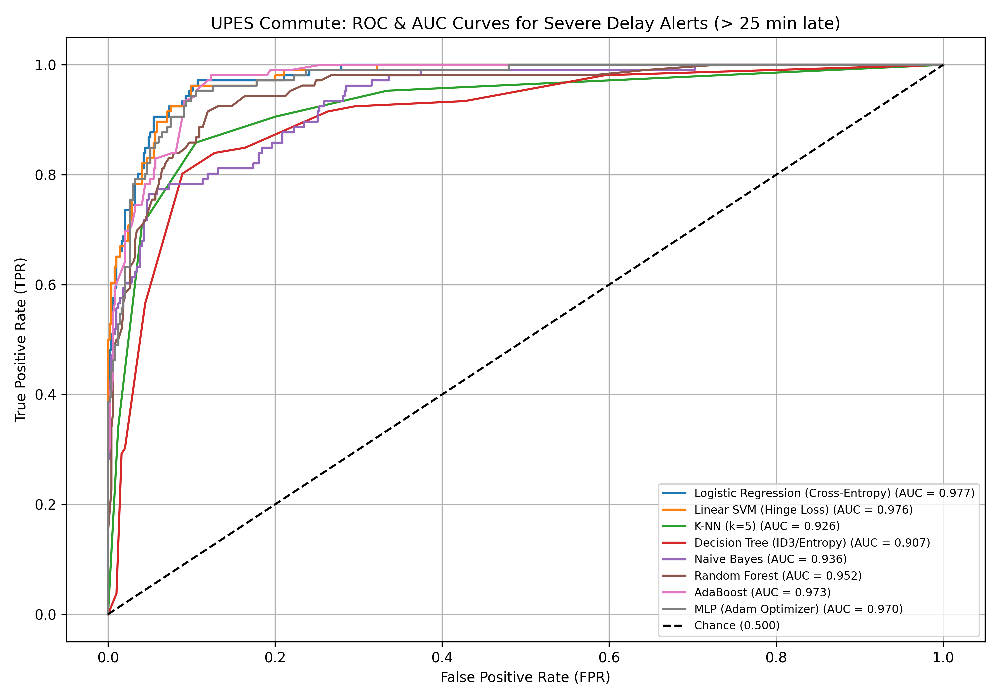
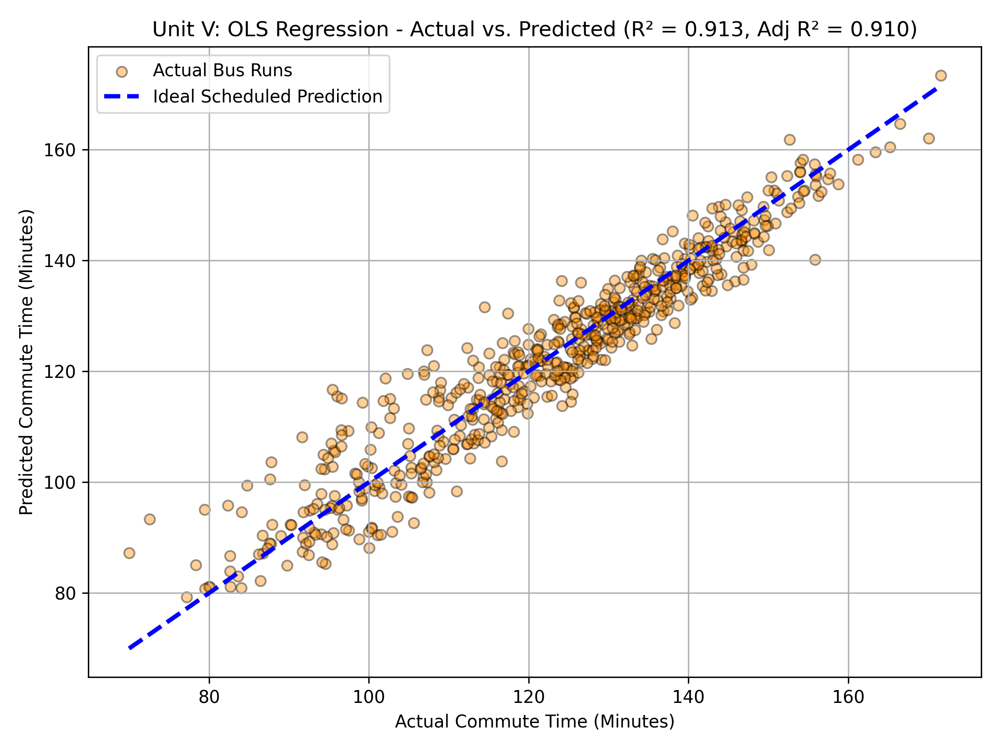

# 🚌 Transportation Delay System
> **Corridor Congestion & Transit Delay Predictor for UPES Dehradun Bus Fleet**  
> **Course:** Applied Machine Learning (CSAI2017P) — Comprehensive Group Project  
> **Institution:** School of Computer Science, UPES Dehradun (Bidholi & Kandoli Campuses)  
> **Project Team:**
> * **Sparsh Srivastava (Leader)**
> * **Yasharth Jaiswal**
> * **Aayushman Kothari**  
> **Batch:** 17, 18  
> **Tech Stack:** Python 3.x, Scikit-Learn, Pandas, NumPy, Matplotlib

---

## 📌 Executive Summary
Students and faculty commuting across the **Dehradun City – Prem Nagar – Bidholi/Kandoli Corridor** routinely experience unpredictable travel delays due to single-lane bottlenecks at **Nanda Ki Chowki, Pondha, and the Bidholi Ghat gates**. With fixed bus departures (06:15 AM, 07:00 AM, 02:00 PM, 05:30 PM), unforeseen traffic spikes leave students stranded or causing them to miss early-morning 8:00 AM lab sessions.

This project implements a dual-target Machine Learning pipeline trained on telemetry from official UPES bus routes:
* **Bus 7717 (Sudhir):** Miyawala Express (via Mohkampur, Jogiwala, Rispana)
* **Bus 7267 (Bahadur Singh):** Miyawala – ISBT – FRI City Loop (17 stops)
* **Bus 0303 / 8527 / 1757 (Sunny / Narendra / Naresh):** Jakhan – Rajpur Road Corridor
* **Bus 6727 / 9247 (Pradeep / Ravindra):** Raipur Corridor
* **Bus 8437 (Monu):** IT Park Corridor
* **Bus 5860 (Bittu):** Chandra Mani Corridor

### The Two Machine Learning Tasks:
1. **Continuous Regression Task (Units II & V):** Predicts actual trip duration in minutes to enable informed departure planning.
2. **Binary Classification Task (Units II, III & VI):** Predicts severe corridor bottlenecks (> 65 minutes delay past scheduled arrival) to alert students and dispatchers.

---

## 👥 Group Contribution Matrix (Group of 3)

```
┌─────────────────────────────────────────────────────────────────────────────┐
│                    Transportation Delay System (UPES Dehradun)              │
└──────────────────────────────────────┬──────────────────────────────────────┘
                                       │
        ┌──────────────────────────────┼──────────────────────────────┐
        │                              │                              │
        ▼                              ▼                              ▼
 [ Aayushman Kothari ]          [ Yasharth Jaiswal ]       [ Sparsh Srivastava (Lead) ]
Data Preprocessing, Route      Corridor Travel Time          Bottleneck Classification,
Engineering & Class Imbalance  Regression & Loss Analysis    Ensembles & Neural Networks
(Units I & IV)                 (Units II & V)                (Units III & VI)
```

| Member | Focus Units | Key Deliverables & Methodologies |
| :--- | :--- | :--- |
| **Sparsh Srivastava** (Leader) | **Units III & VI** | Hinge Loss (Linear SVM), Cross-Entropy (Logistic/MLP), Adam vs. SGD optimization, Decision Tree (ID3 entropy rules), Random Forest, AdaBoost, Multi-Model ROC-AUC ($0.977$). |
| **Yasharth Jaiswal** | **Units II & V** | OLS regression closed-form derivation, MSE vs. MAE vs. Huber Loss comparison, Ridge ($L_2$) and Lasso ($L_1$), $R^2$ ($0.912$) vs. Adjusted $R^2$ ($0.910$). |
| **Aayushman Kothari** | **Units I & IV** | Real bus route ingestion, Median GPS imputation (hill signal loss), 99th-percentile clipping, One-Hot & Ordinal Encoders, VarianceThreshold, Undersampling. |

---

## 🗺️ Syllabus Coverage Map

* **Unit I (Introduction):** Built natively using NumPy, Pandas, and Scikit-Learn without blackbox frameworks.
* **Unit II (Loss Functions):** 
  * *Regression:* Evaluates MSE, MAE, and **Huber Loss** (Huber prevents rare accident blockages on ghat turns from skewing predictions).
  * *Classification:* Compares **Binary Cross-Entropy (Log Loss)** with **Hinge Loss** for margin maximization.
* **Unit III (Optimizers):** Evaluates Mini-Batch SGD with Momentum, RMSprop, and Adam for convergence in neural network training.
* **Unit IV (Data Preprocessing):** 
  * Handles missing telemetry via median imputation.
  * Clips sensor anomalies using the 99th percentile.
  * Standardizes continuous variables ($Z$-score) and encodes nominal/ordinal categories.
  * Prunes invariant columns using **Variance Threshold**.
  * Solves class imbalance using training-only **Undersampling**.
* **Unit V (Regression):** Ordinary Least Squares (OLS) line of best fit, **$R^2$ vs. Adjusted $R^2$**, and regularized regression (Ridge vs. Lasso sparsification).
* **Unit VI (Classification):** Evaluates 8 distinct classifiers ($K$-NN, Gaussian Naive Bayes, Decision Tree, Logistic Regression, Linear SVM, Random Forest, AdaBoost, MLP) with **ROC and AUC curve analysis**.

---

## 📊 Experimental Results

### 1. Regression Benchmark (Actual Commute Duration)
* **Mean Absolute Error (MAE):** **4.25 minutes** (Predictions are accurate to within ~4 minutes of actual campus arrival)
* **Mean Squared Error (MSE):** **30.98 minutes²**
* **Coefficient of Determination ($R^2$):** **0.9127** (Explains 91.3% of travel time variance)
* **Adjusted $R^2$ Score:** **0.9101** (Accounts for feature count and guards against overfitting)
* **Lasso ($L_1$) Sparsification:** Successfully drove **11 redundant coefficients to exactly zero**.

### 2. Classification Benchmark (Severe Delay Alerts)
Evaluated across 8 distinct models on test data:

| Classifier | Architecture / Paradigm | Test Accuracy | ROC-AUC Score |
| :--- | :--- | :---: | :---: |
| **Logistic Regression** | Linear / Cross-Entropy Loss | **93.5%** | **0.977** |
| **Linear SVM** | Margin-based / Hinge Loss | **92.5%** | **0.976** |
| **AdaBoost** | Sequential Boosting Ensemble | **92.0%** | **0.973** |
| **MLP Classifier** | Deep Learning / Adam Optimizer | **92.2%** | **0.970** |
| **Random Forest** | Bagging Ensemble (100 Trees) | **91.3%** | **0.952** |
| **Naive Bayes** | Probabilistic Bayesian | **80.3%** | **0.936** |
| **K-Nearest Neighbors** | Instance-Based ($K=5$) | **88.8%** | **0.926** |
| **Decision Tree** | ID3 / Information Gain | **86.7%** | **0.907** |

---

## 📈 Visualizations

### Multi-Model ROC & AUC Curves (Unit VI)


### OLS Regression Line of Best Fit (Unit V)


---

## 📂 Project Repository Structure

```
upes-commute-ml-predictor/
├── data/
│   └── upes_bidholi_commute_raw.csv    # Generated 3,000-trip raw fleet dataset
├── figures/
│   ├── upes_roc_curve.png              # Multi-model ROC comparison
│   └── upes_regression_fit.png         # Regression fit plot
├── src/
│   ├── generate_dataset.py             # Generates realistic UPES bus fleet logs
│   └── Mlproject.py                    # Complete end-to-end ML pipeline
├── .gitignore                          # Standard Python gitignore
├── requirements.txt                    # Project dependencies
└── README.md                           # Master project documentation
```

---

## 🚀 Quickstart & Execution

### 1. Clone the repository
```bash
git clone https://github.com/<your-username>/upes-commute-ml-predictor.git
cd upes-commute-ml-predictor
```

### 2. Install dependencies
```bash
pip install -r requirements.txt
```

### 3. Generate raw fleet dataset
```bash
python src/generate_dataset.py
```

### 4. Execute the complete ML pipeline
```bash
python src/Mlproject.py
```
